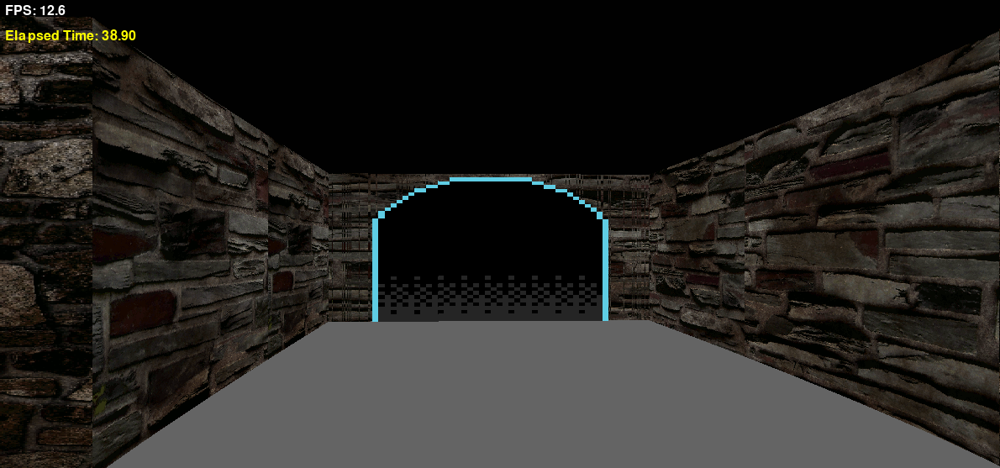

# Maze Escape

A lightweight **DOOM-inspired first-person maze game** built with Python and Pygame.

Explore a procedurally generated maze, locate the Ancient Gateway, and complete each run as quickly as possible. The project explores raycasting, procedural generation, collision detection, texture rendering, and basic game-engine architecture.

**Development note:** ChatGPT was used as a learning and development aid throughout the project.

## Gameplay

Each run generates a maze for the player to explore. Reaching the Ancient Gateway records the completion time and starts a new maze.

## Gameplay Screenshot



## Features

- Procedurally generated mazes using depth-first search
- First-person movement and camera
- DDA raycasting renderer
- Textured walls and floor with ceiling rendering
- Multiple wall textures
- Animated Ancient Gateway
- Completion timer
- Automatic maze regeneration
- Lightweight rendering designed for modest hardware

## Controls

| Key | Action |
|---|---|
| `W` | Move forward |
| `S` | Move backward |
| `A` | Move left |
| `D` | Move right |
| `←` / `→` | Rotate the camera left / right |


## Scope

### Included

- Procedural maze generation
- First-person movement and collision detection
- Raycasting and perspective projection
- Wall, floor, and ceiling rendering
- Wall texture mapping
- Gateway animation and completion detection
- Timer and endless gameplay loop

### Excluded

- Enemies and combat
- Weapons and health
- Inventory and keys
- Locked doors and NPCs
- Multiplayer
- Audio
- Complex menus

The scope is intentionally limited to keep the project focused and lightweight.

## Tech Stack

- Python
- Pygame
- Procedural generation
- DDA raycasting
- Git and GitHub

## Project Structure

```text
Maze-Escape/
├── assets/
│   ├── door/
│   ├── floor/
│   └── walls/
├── animation.py
├── game.py
├── gateway.py
├── main.py
├── maze.py
├── player.py
├── raycaster.py
├── renderer.py
├── settings.py
├── texture.py
├── requirements.txt
└── README.md
```

Adjust the asset subfolder names or file list if your current repository differs.

## Installation

Python 3.10 or newer is recommended, subject to compatibility with the dependencies.

Clone the repository:

```bash
git clone https://github.com/nerd-10/Maze-Escape
cd Maze-Escape
```

Create a virtual environment:

```bash
python -m venv .venv
```

Activate it on Windows:

```powershell
.venv\Scripts\Activate.ps1
```

Install dependencies:

```bash
python -m pip install -r requirements.txt
```

## Run the Game

```bash
python main.py
```

Use the controls implemented in the game to explore the maze and reach the Ancient Gateway.

## Learning Goals

This project is an exercise in building a small first-person rendering engine without relying on an existing 3D engine.

Key concepts include:

- Depth-first search for procedural maze generation
- Breadth-first search for maze-distance calculations
- DDA raycasting for wall intersections
- Camera-space projection and perspective
- Collision detection
- Texture mapping and sprite rendering
- Game-loop timing and state management

## Future Improvements

Potential improvements are limited to polish and reliability, such as rendering refinements, automated tests, performance measurements, and documentation.

New gameplay systems are intentionally outside the current project scope.